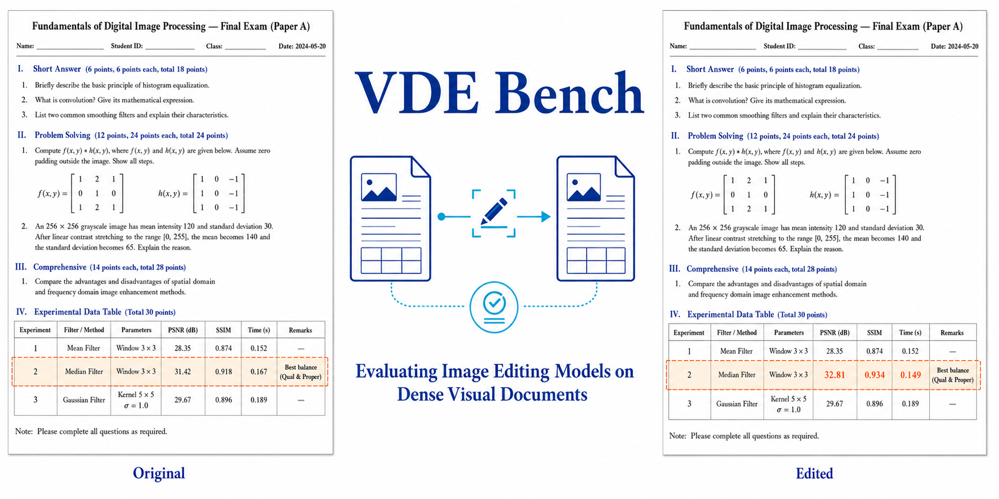

# VDE-Bench: Visual Document Editing Benchmark

[](https://arxiv.org/abs/2602.00122)
[](https://huggingface.co/datasets/hongzhuyi/VDEBench)
[](https://huggingface.co/datasets/hongzhuyi/VDEBench)

[[Paper]](https://arxiv.org/abs/2602.00122)
[[Dataset]](https://huggingface.co/datasets/hongzhuyi/VDEBench)
[[Dataset Mirror / 数据集镜像]](https://hf-mirror.com/datasets/hongzhuyi/VDEBench)

[English](#english-introduction) | [简体中文](#中文介绍) | [News / 最新动态](#news) | [Quick Start](#quick-start)

## News

- **2026-01-27 — arXiv:** The first version of our [paper](https://arxiv.org/abs/2602.00122v1) was submitted to arXiv. / 论文首版提交至 arXiv。
- **2026-10-28 — Hugging Face Official Benchmark:** VDE-Bench is now an **official benchmark on the Hugging Face Hub**, with a live leaderboard for local and global document-editing evaluation. Thanks to the Hugging Face team for supporting the integration! [Dataset & leaderboard](https://huggingface.co/datasets/hongzhuyi/VDEBench) · [Hugging Face confirmation](https://huggingface.co/datasets/hongzhuyi/VDEBench/discussions/2#6ae1ea439ae693f8c312af8d). / VDE-Bench 已被 **Hugging Face 官方收录为 Hub 官方评测基准**，局部编辑与整页评测排行榜正式上线。感谢 Hugging Face 团队的支持！

## English Introduction

**VDE-Bench (Visual Document Editing Benchmark)** evaluates how well image-editing models follow natural-language instructions to make precise changes to **dense Chinese and English document images**. Models must locate and edit the requested text or table content while preserving the surrounding text, table structure, typography, and page layout.

The benchmark contains **3,506 instruction-guided editing examples**, comprising **1,578 text-region edits** and **1,928 table-region edits** across **seven task types**: text replacement, addition, and deletion; table text modification, addition, and deletion; and table structure editing. Each example pairs an input image, an editing instruction, and a reference target image with editing-region and structured OCR annotations.

VDE-Bench combines **local edit-region evaluation** with **global full-page evaluation** to assess textual correctness, structural fidelity, and visual content preservation. The evaluation toolkit includes OCR-based metrics (IoU, CDM, BLEU, and TEDS) and image-quality metrics (PSNR, SSIM, LPIPS, FID, and CLIP Score). The dataset and its official Hub leaderboard are available on [Hugging Face](https://huggingface.co/datasets/hongzhuyi/VDEBench); this repository provides the data-generation and evaluation code.

## 中文介绍

**VDE-Bench（视觉文档编辑评测基准）**用于评估图像编辑模型能否遵循自然语言指令，对**中文和英文的高密度文档图像**进行精确修改。模型需要准确定位并编辑指定的文本或表格内容，同时保持周围文字、表格结构、字体样式和页面布局。

基准包含 **3,506 个指令驱动的编辑样本**，其中包括 **1,578 个文本区域编辑样本**和 **1,928 个表格区域编辑样本**，覆盖**七类任务**：文本替换、新增与删除，表格内文字修改、新增与删除，以及表格结构编辑。每个样本均提供输入图像、编辑指令、参考目标图像，以及编辑区域和结构化 OCR 标注。

VDE-Bench 结合**局部编辑区域评测**与**全局整页评测**，从文本正确性、结构保真度和视觉内容保持三个方面衡量编辑质量。评测工具包括基于 OCR 的指标（IoU、CDM、BLEU、TEDS）和图像质量指标（PSNR、SSIM、LPIPS、FID、CLIP Score）。数据集及其 Hub 官方排行榜已上线 [Hugging Face](https://huggingface.co/datasets/hongzhuyi/VDEBench)（[国内镜像](https://hf-mirror.com/datasets/hongzhuyi/VDEBench)）；本仓库提供数据生成与评测代码。



## Repository Contents

This repository contains:

1. **Data generation pipeline** (`data_generation/`): scripts that build the benchmark by calling a multimodal LLM on source document images such as [OmniDocBench](https://github.com/opendatalab/OmniDocBench).
2. **OCR and layout evaluation** (`evaluation/ocr_eval/`): the main OCR benchmark, with per-block IoU, CDM, BLEU, and TEDS metrics at both *global* and *local (edit-region)* levels.
3. **Image-quality evaluation** (`evaluation/image_quality/`): perceptual metrics including PSNR, SSIM, LPIPS, FID, and CLIP Score.
4. **Layout analysis** (`evaluation/layout_analysis/`): document layout element extraction and distribution statistics using a vision LLM.
5. **Annotator-agreement analysis** (`evaluation/agreement/`): Fleiss' Kappa and Krippendorff's Alpha implementations for human-rating studies.
6. **Dataset statistics and reports** (`analysis/`): scripts to plot dataset distributions and render LaTeX tables for the paper.
7. **OCR backends** (`ocr_backends/`): example configurations for PaddleOCR-VL and Hunyuan OCR.

> The benchmark data, including images, instructions, OCR outputs, and human labels, is available separately on [Hugging Face](https://huggingface.co/datasets/hongzhuyi/VDEBench). This repository contains the code.

---

## Table of Contents

- [News](#news)
- [English Introduction](#english-introduction)
- [中文介绍](#中文介绍)
- [Repository Contents](#repository-contents)
- [Installation](#installation)
- [Repository Layout](#repository-layout)
- [Quick Start](#quick-start)
  - [1. Generating the benchmark](#1-generating-the-benchmark)
  - [2. Running OCR on predictions](#2-running-ocr-on-predictions)
  - [3. OCR-based evaluation](#3-ocr-based-evaluation)
  - [4. Image-quality evaluation](#4-image-quality-evaluation)
  - [5. Layout analysis](#5-layout-analysis)
  - [6. Inter-annotator agreement](#6-inter-annotator-agreement)
- [Data Format](#data-format)
- [Citation](#citation)
- [License](#license)

---

## Installation

```bash
git clone https://github.com/zion-zion-zion/VDE-Bench.git
cd VDE-Bench

# Core dependencies
pip install -r requirements.txt

# Sub-module specific dependencies (install only what you need)
pip install -r evaluation/image_quality/requirements.txt
pip install -r evaluation/layout_analysis/requirements.txt
```

Tested with **Python 3.10+**, **PyTorch 2.x**, and **CUDA 11.8 / 12.1**.

---

## Repository Layout

```
VDE-Bench/
├── data_generation/            # Scripts to build the benchmark
│   ├── prompts.py              # All editing prompts (text / table / figure)
│   ├── llm_client.py           # Thin OpenAI-compatible client for image-editing & text LLMs
│   ├── edit_table_crop.py      # Crop+edit table regions (nano image-edit LLM)
│   ├── edit_figure_crop.py     # Crop+edit figure regions
│   ├── edit_text_fullpage.py   # Full-page text editing (given an instruction)
│   ├── edit_table_fullpage.py  # Full-page table editing
│   ├── generate_text_instruction.py   # Generate text add/delete instructions
│   ├── generate_table_instruction.py  # Generate table add/delete/structure-edit instructions
│   ├── infer_instruction_from_pair.py # Infer editing instruction from (before, after) pair
│   ├── classify_instruction.py        # Classify instruction into text-add / text-delete / table-structure
│   ├── pdf_to_images.py               # PDF -> page images
│   ├── paste_labeled_region.py        # Paste human-labeled region back into the original image
│   ├── merge_and_copy_images.py       # Merge multiple info JSONs + copy & rename images
│   ├── filter_high_score_items.py     # Keep only items rated 3/3 by reviewers
│   └── filter_by_id.py                # Intersect two JSONs by `image_input`
│
├── evaluation/
│   ├── ocr_eval/               # Main OCR benchmark
│   │   ├── eval_unified.py             # Unified text+table OCR evaluation (global / local modes)
│   │   ├── eval_text_region.py         # Stand-alone text-region evaluation
│   │   ├── run_eval_ocr.sh             # Example runner (global)
│   │   └── run_eval_ocr_local.sh       # Example runner (local, edit-region-only)
│   │
│   ├── image_quality/          # PSNR / SSIM / LPIPS / FID / CLIP Score
│   │   ├── evaluate.py
│   │   ├── metrics.py
│   │   ├── run_eval.sh
│   │   ├── run_eval_local.sh
│   │   └── requirements.txt
│   │
│   ├── layout_analysis/        # Layout element extraction + distribution metrics
│   │   ├── main.py
│   │   ├── constants.py
│   │   ├── extraction.py
│   │   ├── metrics.py
│   │   ├── visualization.py
│   │   ├── report.py
│   │   ├── generate_heatmap.py
│   │   ├── layout_evaluation.py
│   │   ├── run_vlm.sh
│   │   └── requirements.txt
│   │
│   └── agreement/              # Inter-annotator agreement (Fleiss kappa, Krippendorff alpha)
│       ├── fleiss_kappa.py
│       ├── krippendorff_alpha.py
│       └── metrics.py
│
├── analysis/                   # Paper-time analysis / table & figure generation
│   ├── plot_dataset_statistics.py
│   ├── compute_edit_type_metrics.py
│   ├── compute_edit_type_metrics_global.py
│   ├── compute_language_metrics.py
│   ├── generate_results_table.py
│   ├── ambiguify_instructions.py
│   ├── check_image_output.py
│   ├── clean_table_output.py
│   └── fix_missing_data_source.py
│
├── ocr_backends/
│   ├── paddleocr_vl/
│   │   ├── run_paddle_server.sh        # vLLM-hosted PaddleOCR-VL server
│   │   └── paddle_ocr_client.py        # Minimal client
│   └── hunyuan_ocr/
│       └── hunyuan_client.py
│
├── scripts/
│   └── upload_to_hf.py         # Helper to push a data archive to HuggingFace
│
├── requirements.txt
├── LICENSE
├── .gitignore
└── README.md
```

---

## Quick Start

All scripts that call a hosted (OpenAI-compatible) LLM expect the following environment variables:

```bash
export LLM_API_BASE="https://your-llm-endpoint.example.com/v1"
export LLM_API_KEY="sk-your-token-here"
```

They can also be passed as CLI flags (`--api_base`, `--api_key`). **Never hard-code credentials in source files.**

### 1. Generating the benchmark

From raw source document images and their OCR annotations (OmniDocBench format):

```bash
# (a) crop + edit each table region
python data_generation/edit_table_crop.py \
    --source_json /path/to/OmniDocBench.json \
    --image_root  /path/to/source/images \
    --output_dir  outputs/table_edited \
    --output_json outputs/table_edited.json \
    --model gemini-3-pro-image \
    --num_samples 150

# (b) generate text editing instructions, then apply them
python data_generation/generate_text_instruction.py \
    --source_json /path/to/OmniDocBench.json \
    --image_root  /path/to/source/images \
    --output_json outputs/text_instructions.json \
    --model gemini-2.5-flash

python data_generation/edit_text_fullpage.py \
    --instruction_json outputs/text_instructions.json \
    --output_dir       outputs/text_edited \
    --output_json      outputs/text_edited.json \
    --model gemini-3-pro-image
```

### 2. Running OCR on predictions

```bash
# Option A: PaddleOCR-VL via vLLM
bash ocr_backends/paddleocr_vl/run_paddle_server.sh   # starts server on :8118
python ocr_backends/paddleocr_vl/paddle_ocr_client.py \
    --image_dir /path/to/predicted_images \
    --output_dir /path/to/predicted_ocr
```

### 3. OCR-based evaluation

Evaluate on *both* text and table edits in one pass:

```bash
bash evaluation/ocr_eval/run_eval_ocr.sh \
    <MODEL_NAME> \
    /path/to/<model>_text_ocr \
    /path/to/<model>_table_ocr
```

For *local* (edit-region-only) evaluation, use the human-labeled bboxes:

```bash
bash evaluation/ocr_eval/run_eval_ocr_local.sh \
    <MODEL_NAME> \
    /path/to/<model>_text_ocr \
    /path/to/<model>_table_ocr
```

Metrics reported per block and in aggregate:

| Metric | Level | Notes |
|--------|-------|-------|
| IoU    | block | over `matched ∪ unmatched_gt` blocks |
| CDM    | block | Character-level Detection Match, over matched blocks only |
| BLEU   | block | BLEU over matched blocks only |
| TEDS   | block | Table-only, over matched blocks only |

### 4. Image-quality evaluation

```bash
python evaluation/image_quality/evaluate.py \
    --groups \
        text  <text_info.json>  <gt_dir>  <pred_dir> \
        table <table_info.json> <gt_dir>  <pred_dir> \
    --padding 0 --device cuda \
    --output_json results_iq.json
```

Pass `none` in place of the info-JSON to run in global (full-image) mode.

### 5. Layout analysis

```bash
# (a) host a vision LLM for element extraction (vLLM example)
bash evaluation/layout_analysis/run_vlm.sh

# (b) run the pipeline
python evaluation/layout_analysis/main.py run \
    --image_dir /path/to/document_images \
    --output_dir ./layout_results \
    --model vlm --port 63332
```

### 6. Inter-annotator agreement

```bash
python evaluation/agreement/fleiss_kappa.py \
    --input ratings.json \
    --dimensions spatial textual style
python evaluation/agreement/krippendorff_alpha.py \
    --input ratings.json
```

---

## Data Format

**Editing item** JSON (the format of each benchmark entry):

```json
{
  "id": 48234,
  "image_input":  "inputs/<document>_page_<n>.jpg",
  "image_output": "outputs/<document>_page_<n>_modified.png",
  "instruction":  "Delete the text \"Win on cost and scale\" from the sub-header.",
  "instruction type": "text deletion",
  "language":     "english",
  "data_source":  "eastmoney",
  "label_output": [
    {"x": 12.3, "y": 4.1, "width": 30.0, "height": 4.5}
  ]
}
```

- `label_output` bboxes are percentages relative to the edited image.
- See `evaluation/ocr_eval/eval_unified.py` for exact matching rules.

---

## Citation

If you find VDE-Bench useful, please cite:

```bibtex
@article{yi2026vdebench,
  title   = {VDE Bench: Evaluating The Capability of Image Editing Models to Modify Visual Documents},
  author  = {Yi, Hongzhu and Yang, Yujia and Wang, Yuanxiang and Guan, Zhenyu and Chen, Jiahuan and Bao, Chenxi and Yang, Tiankun and Yuan, Yixuan and Zong, Tianyu and Wang, Xinming and Yu, Tao and Tao, Ruiwen and Liang, Haijin and Ma, Jin and Luo, Jinwen and Zuo, Yeshani Xinyu and Xu, Jungang},
  journal = {arXiv preprint arXiv:2602.00122},
  year    = {2026}
}
```

---

## License

This project is released under the [Apache License 2.0](./LICENSE).
The underlying document data may be subject to separate licenses from their respective source datasets (e.g. OmniDocBench). Please consult those repositories before redistribution.
