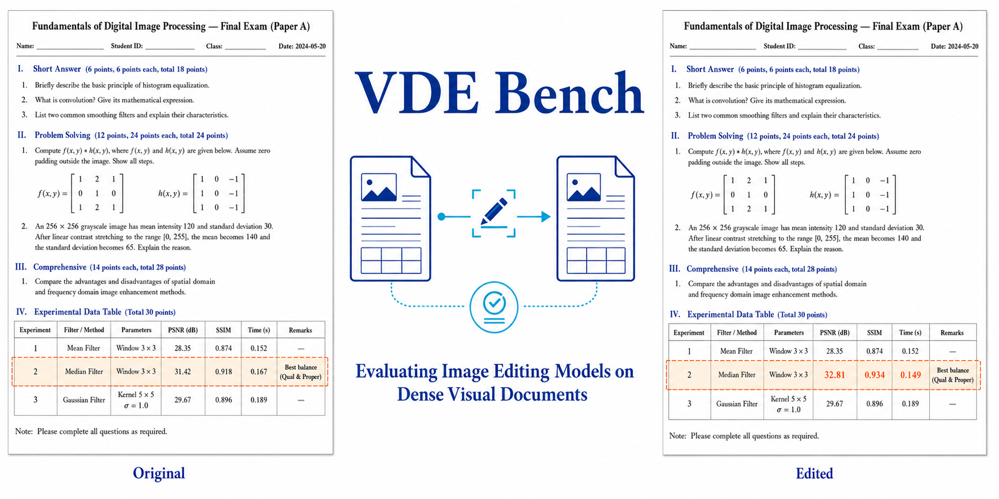

<div align="center">

# 📄 VDE-Bench：视觉文档编辑评测基准

**“精准编辑目标文本与表格，完整保留文档其余版面与内容。”**

*面向中英文高密度文档图像的指令驱动编辑评测基准*

[](https://arxiv.org/abs/2602.00122)
[](https://huggingface.co/datasets/hongzhuyi/VDEBench)
[](https://huggingface.co/datasets/hongzhuyi/VDEBench)
[](https://hf-mirror.com/datasets/hongzhuyi/VDEBench)
[](./LICENSE)

**[英文版](README.md)** · **[简体中文](README_zh.md)**

[最新动态](#最新动态) · [核心亮点](#核心亮点) · [评测榜单](#评测榜单) · [任务体系与数据分布](#任务体系与数据分布) · [快速开始](#快速开始) · [引用](#引用)

</div>

---

<div align="center">

| 样本总数 | 文本区域编辑 | 表格区域编辑 | 覆盖语言 | 任务类型 | 评测粒度 |
|:---:|:---:|:---:|:---:|:---:|:---:|
| **3,506** | **1,578** | **1,928** | **中文 · 英文** | **7 类** | **局部区域 · 全局整页** |

</div>

## 最新动态

- 🚀 **2026-11-01 — 主流模型全量评测榜单发布：** 六款主流图像编辑模型（`FLUX.2-klein-4B`、`BAGEL-7B-MoT`、`Qwen-Image-Edit-2511`、`FireRed-Image-Edit-1.1`、`Qwen-Image-Edit-2509`、`OmniGen2`）在全部 **3,506 个测试样本**上的**局部（Local）**与**全局（Global）**评测结果已上线 [Hugging Face 评测榜单](https://huggingface.co/datasets/hongzhuyi/VDEBench/blob/main/results/2026-11-01/README.md)。
- 🤗 **2026-10-28 — Hugging Face 官方收录：** VDE-Bench 已被 **Hugging Face 官方收录为 Hub 官方评测基准**，局部编辑与整页评测排行榜正式上线！🎉 感谢 Hugging Face 团队的支持！[[数据集与排行榜]](https://huggingface.co/datasets/hongzhuyi/VDEBench) · [[数据集镜像]](https://hf-mirror.com/datasets/hongzhuyi/VDEBench) · [[官方确认]](https://huggingface.co/datasets/hongzhuyi/VDEBench/discussions/2#6ae1ea439ae693f8c312af8d)

## 项目介绍

**VDE-Bench（视觉文档编辑评测基准）**用于评估图像编辑模型能否遵循自然语言指令，对**中文和英文的高密度文档图像**进行精确修改。模型需要准确定位并编辑指定的文本或表格内容，同时保持周围文字、表格结构、字体样式和页面布局。

基准包含 **3,506 个指令驱动的编辑样本**，其中包括 **1,578 个文本区域编辑样本**和 **1,928 个表格区域编辑样本**，覆盖**七类任务**：文本替换、新增与删除，表格内文字修改、新增与删除，以及表格结构编辑。每个样本均提供输入图像、自然语言编辑指令、参考目标图像，以及允许编辑区域掩码、实际变更像素掩码与结构化 OCR 标注。

<p align="center">
  
</p>

## 核心亮点

- **🎯 真实高密度双语文档场景：** 样本精选自多样化的中英文真实文档页面（涵盖 [OmniDocBench](https://github.com/opendatalab/OmniDocBench)、[DocGenome](https://huggingface.co/datasets/U4R/DocGenome) 与 [DocLayNet](https://github.com/DS4SD/DocLayNet)），考察模型在紧密耦合版面中的细粒度编辑能力。
- **🧩 七大细粒度文档编辑任务：** 系统覆盖**文本替换**、**文本新增**、**文本删除**、**表格文字修改**、**表格文字新增**、**表格文字删除**以及**表格结构编辑**。
- **⚖️ 局部与全局双粒度评测协议：** 同时开展**局部编辑区域（Local）**与**全局整页（Global）**评测，既检验目标区域是否按指令精准修改，也检验未编辑区域是否保持零误伤。
- **📐 多维度综合指标体系：** 融合文本与结构解析指标（`IoU`、`CDM`、`BLEU-4`、`TEDS`）以及感知与语义图像质量指标（`PSNR`、`SSIM`、`LPIPS`、`FID`、`CLIP Score`）。
- **🛠️ 开箱即用的完整开源工具链：** 提供 Hugging Face Parquet 流式数据加载、多模态大模型数据合成流水线、基于 vLLM 的 OCR 推理后端（`PaddleOCR-VL`、`Hunyuan OCR`）、版面元素统计以及人工评分一致性分析（`Fleiss' Kappa`、`Krippendorff's Alpha`）。

## 评测榜单

下表展示了六款主流图像编辑模型在全部 **3,506 个测试样本**（`default/test` 划分）上的完整评测结果。**局部得分（Local）**为主榜单核心指标；局部与全局得分均取四项块级汇总 OCR 指标的等权均值 `(IoU + CDM + BLEU-4 + TEDS) / 4`（范围 `0–1`，越高越好）。

<div align="center">

| 排名 | 模型 | 局部得分 Local ↑ *(核心指标)* | 全局得分 Global ↑ | 详细分项结果 |
|:---:|---|:---:|:---:|:---:|
| 🥇 | **[FLUX.2-klein-4B](https://huggingface.co/black-forest-labs/FLUX.2-klein-4B)** | **0.767** | **0.807** | [JSON](https://huggingface.co/datasets/hongzhuyi/VDEBench/blob/main/results/2026-11-01/flux2_klein_4b/results.json) |
| 🥈 | **[BAGEL-7B-MoT](https://huggingface.co/ByteDance-Seed/BAGEL-7B-MoT)** | **0.706** | **0.786** | [JSON](https://huggingface.co/datasets/hongzhuyi/VDEBench/blob/main/results/2026-11-01/bagel_7b_mot/results.json) |
| 🥉 | **[Qwen-Image-Edit-2511](https://huggingface.co/Qwen/Qwen-Image-Edit-2511)** | **0.656** | 0.699 | [JSON](https://huggingface.co/datasets/hongzhuyi/VDEBench/blob/main/results/2026-11-01/qwen_image_edit_2511/results.json) |
| 4 | **[FireRed-Image-Edit-1.1](https://huggingface.co/FireRedTeam/FireRed-Image-Edit-1.1)** | 0.638 | 0.750 | [JSON](https://huggingface.co/datasets/hongzhuyi/VDEBench/blob/main/results/2026-11-01/firered_image_edit_1_1/results.json) |
| 5 | **[Qwen-Image-Edit-2509](https://huggingface.co/Qwen/Qwen-Image-Edit-2509)** | 0.618 | 0.639 | [JSON](https://huggingface.co/datasets/hongzhuyi/VDEBench/blob/main/results/2026-11-01/qwen_image_edit_2509/results.json) |
| 6 | **[OmniGen2](https://huggingface.co/OmniGen2/OmniGen2)** | 0.565 | 0.581 | [JSON](https://huggingface.co/datasets/hongzhuyi/VDEBench/blob/main/results/2026-11-01/omnigen2/results.json) |

</div>

> 💡 交互式完整榜单及更多早期模型结果请访问 [Hugging Face 数据集主页](https://huggingface.co/datasets/hongzhuyi/VDEBench)（或通过 [HF-Mirror 镜像](https://hf-mirror.com/datasets/hongzhuyi/VDEBench) 查看）。

## 任务体系与数据分布

所有配置均通过统一的 `test` 划分提供评测基准。`default` 配置包含全部 **3,506** 个样本，`text` 与 `table` 分别对应文本与表格两个子集：

<div align="center">

| 区域子集 | 编辑任务类型 | 样本数 | 占比 | 核心考察点 |
|---|---|---:|---:|---|
| **文本区域** (`1,578`) | 文本替换 | 575 | 16.4% | 字符精准替换与字体样式一致性 |
| **文本区域** (`1,578`) | 文本新增 | 504 | 14.4% | 行或段落插入及局部排版自适应 |
| **文本区域** (`1,578`) | 文本删除 | 499 | 14.2% | 干净移除指定文字并自然修复背景 |
| **表格区域** (`1,928`) | 表格文字修改 | 524 | 14.9% | 单元格内文字修改且不破坏表格边框 |
| **表格区域** (`1,928`) | 表格文字新增 | 472 | 13.5% | 填入单元格内容并保持行列对齐 |
| **表格区域** (`1,928`) | 表格文字删除 | 472 | 13.5% | 清空单元格内容同时完整保留表格线 |
| **表格区域** (`1,928`) | 表格结构编辑 | 460 | 13.1% | 行列增删与单元格合并拆分（`TEDS`） |
| **总计** | **7 类任务** | **3,506** | **100.0%** | **局部编辑区域 + 全局整页联合评估** |

</div>

## 仓库内容

| 模块名称 | 路径 | 功能说明 |
|---|---|---|
| **数据生成流程** | `data_generation/` | 调用多模态大语言模型完成区域裁剪编辑、指令合成与高质量样本筛选 |
| **OCR 与版面评测** | `evaluation/ocr_eval/` | 核心 OCR 评测模块，支持全局与局部模式下的 `IoU`、`CDM`、`BLEU-4`、`TEDS` 计算 |
| **图像质量评测** | `evaluation/image_quality/` | 计算 `PSNR`、`SSIM`、`LPIPS`、`FID` 与 `CLIP Score` 等感知和语义指标 |
| **版面分析** | `evaluation/layout_analysis/` | 基于视觉大语言模型提取文档版面元素、生成热力图与空间分布报告 |
| **标注者一致性分析** | `evaluation/agreement/` | 提供 `Fleiss' Kappa` 与 `Krippendorff's Alpha` 实现，评估人工评分一致性 |
| **数据集统计与报告** | `analysis/` | 绘制数据集分布统计图、分语言与分任务指标汇总及论文 LaTeX 表格生成 |
| **OCR 后端** | `ocr_backends/` | 提供 `PaddleOCR-VL`（基于 vLLM）和 `Hunyuan OCR` 的服务部署与客户端脚本 |

## 目录

- [最新动态](#最新动态)
- [项目介绍](#项目介绍)
- [核心亮点](#核心亮点)
- [评测榜单](#评测榜单)
- [任务体系与数据分布](#任务体系与数据分布)
- [仓库内容](#仓库内容)
- [安装](#安装)
- [目录结构](#目录结构)
- [快速开始](#快速开始)
  - [0. 从 Hugging Face 加载数据集](#0-从-hugging-face-加载数据集)
  - [1. 生成评测数据](#1-生成评测数据)
  - [2. 对模型预测图像运行 OCR](#2-对模型预测图像运行-ocr)
  - [3. 基于 OCR 的评测](#3-基于-ocr-的评测)
  - [4. 图像质量评测](#4-图像质量评测)
  - [5. 版面分析](#5-版面分析)
  - [6. 标注者一致性分析](#6-标注者一致性分析)
- [数据格式](#数据格式)
- [引用](#引用)
- [许可证](#许可证)

---

## 安装

```bash
git clone https://github.com/zion-zion-zion/VDE-Bench.git
cd VDE-Bench

# 安装核心依赖
pip install -r requirements.txt

# 按需安装各子模块的依赖
pip install -r evaluation/image_quality/requirements.txt
pip install -r evaluation/layout_analysis/requirements.txt
```

已测试的环境为 **Python 3.10+**、**PyTorch 2.x** 和 **CUDA 11.8 / 12.1**。

---

## 目录结构

<details open>
<summary><strong>点击展开或折叠完整目录树</strong></summary>

```text
VDE-Bench/
├── data_generation/            # 评测数据构建脚本
│   ├── prompts.py              # 文本、表格和插图编辑提示词
│   ├── llm_client.py           # 兼容 OpenAI 接口的图像编辑与文本模型客户端
│   ├── edit_table_crop.py      # 裁剪并编辑表格区域
│   ├── edit_figure_crop.py     # 裁剪并编辑插图区域
│   ├── edit_text_fullpage.py   # 根据指令编辑整页中的文本
│   ├── edit_table_fullpage.py  # 整页表格编辑
│   ├── generate_text_instruction.py   # 生成文本新增与删除指令
│   ├── generate_table_instruction.py  # 生成表格新增、删除与结构编辑指令
│   ├── infer_instruction_from_pair.py # 根据编辑前后的图像对推断指令
│   ├── classify_instruction.py        # 将指令分类为文本新增、文本删除或表格结构编辑
│   ├── pdf_to_images.py               # 将 PDF 页面转换为图像
│   ├── paste_labeled_region.py        # 将人工标注的区域贴回原始图像
│   ├── merge_and_copy_images.py       # 合并多个信息 JSON，并复制、重命名图像
│   ├── filter_high_score_items.py     # 保留获得评审者满分 3 分的样本
│   └── filter_by_id.py                # 根据 image_input 对两个 JSON 取交集
│
├── evaluation/
│   ├── ocr_eval/               # 主要 OCR 评测模块
│   │   ├── eval_unified.py             # 文本与表格的统一 OCR 评测，支持全局和局部模式
│   │   ├── eval_text_region.py         # 独立的文本区域评测
│   │   ├── run_eval_ocr.sh             # 全局评测运行示例
│   │   └── run_eval_ocr_local.sh       # 仅针对编辑区域的局部评测运行示例
│   │
│   ├── image_quality/          # PSNR、SSIM、LPIPS、FID 和 CLIP Score
│   │   ├── evaluate.py
│   │   ├── metrics.py
│   │   ├── run_eval.sh
│   │   ├── run_eval_local.sh
│   │   └── requirements.txt
│   │
│   ├── layout_analysis/        # 版面元素提取与分布统计
│   │   ├── main.py
│   │   ├── constants.py
│   │   ├── extraction.py
│   │   ├── metrics.py
│   │   ├── visualization.py
│   │   ├── report.py
│   │   ├── generate_heatmap.py
│   │   ├── layout_evaluation.py
│   │   ├── run_vlm.sh
│   │   └── requirements.txt
│   │
│   └── agreement/              # 标注者一致性分析
│       ├── fleiss_kappa.py
│       ├── krippendorff_alpha.py
│       └── metrics.py
│
├── analysis/                   # 论文使用的统计分析、表格与图像生成脚本
│   ├── plot_dataset_statistics.py
│   ├── compute_edit_type_metrics.py
│   ├── compute_edit_type_metrics_global.py
│   ├── compute_language_metrics.py
│   ├── generate_results_table.py
│   ├── ambiguify_instructions.py
│   ├── check_image_output.py
│   ├── clean_table_output.py
│   └── fix_missing_data_source.py
│
├── ocr_backends/
│   ├── paddleocr_vl/
│   │   ├── run_paddle_server.sh        # 通过 vLLM 部署 PaddleOCR-VL 服务
│   │   └── paddle_ocr_client.py        # 精简客户端
│   └── hunyuan_ocr/
│       └── hunyuan_client.py
│
├── scripts/
│   └── upload_to_hf.py         # 将数据归档上传至 Hugging Face
│
├── requirements.txt
├── LICENSE
├── .gitignore
├── README.md                   # 英文文档
└── README_zh.md                # 简体中文文档
```

</details>

---

## 快速开始

### 0. 从 Hugging Face 加载数据集

可以直接通过 `datasets` 库流式读取或下载完整评测数据，无需手动解压归档文件：

```python
from datasets import load_dataset

# 可选配置：name="default"（全部 3,506 条）、"text"（1,578 条）或 "table"（1,928 条）
ds = load_dataset(
    "hongzhuyi/VDEBench",
    name="default",
    split="test",
    streaming=True,
)

example = next(iter(ds))
print(example["id"], example["instruction"])
example["image_input"].save("input.png")
example["image_output"].save("reference.png")
```

所有调用托管大语言模型服务、使用兼容 OpenAI 接口的脚本，都需要配置以下环境变量：

```bash
export LLM_API_BASE="https://your-llm-endpoint.example.com/v1"
export LLM_API_KEY="sk-your-token-here"
```

也可以通过命令行参数 `--api_base` 和 `--api_key` 传入这些配置。**请勿将凭据直接写入源代码。**

### 1. 生成评测数据

准备原始文档图像及其 OCR 标注，标注采用 OmniDocBench 格式：

```bash
# （a）裁剪并编辑各表格区域
python data_generation/edit_table_crop.py \
    --source_json /path/to/OmniDocBench.json \
    --image_root  /path/to/source/images \
    --output_dir  outputs/table_edited \
    --output_json outputs/table_edited.json \
    --model gemini-3-pro-image \
    --num_samples 150

# （b）生成文本编辑指令，再根据指令编辑图像
python data_generation/generate_text_instruction.py \
    --source_json /path/to/OmniDocBench.json \
    --image_root  /path/to/source/images \
    --output_json outputs/text_instructions.json \
    --model gemini-2.5-flash

python data_generation/edit_text_fullpage.py \
    --instruction_json outputs/text_instructions.json \
    --output_dir       outputs/text_edited \
    --output_json      outputs/text_edited.json \
    --model gemini-3-pro-image
```

### 2. 对模型预测图像运行 OCR

```bash
# 方案 A：通过 vLLM 部署 PaddleOCR-VL
bash ocr_backends/paddleocr_vl/run_paddle_server.sh   # 在 8118 端口启动服务
python ocr_backends/paddleocr_vl/paddle_ocr_client.py \
    --image_dir /path/to/predicted_images \
    --output_dir /path/to/predicted_ocr
```

### 3. 基于 OCR 的评测

一次评测同时覆盖*文本编辑*与*表格编辑*：

```bash
bash evaluation/ocr_eval/run_eval_ocr.sh \
    <MODEL_NAME> \
    /path/to/<model>_text_ocr \
    /path/to/<model>_table_ocr
```

进行*局部评测*（仅评估编辑区域）时，使用人工标注的边界框：

```bash
bash evaluation/ocr_eval/run_eval_ocr_local.sh \
    <MODEL_NAME> \
    /path/to/<model>_text_ocr \
    /path/to/<model>_table_ocr
```

以下指标会以块级结果和汇总结果两种形式报告：

| 指标 | 层级 | 说明 |
|------|------|------|
| IoU | 块级 | 在已匹配块与未匹配的真实标注块的并集，即 `matched ∪ unmatched_gt` 上计算 |
| CDM | 块级 | 字符级检测匹配指标，仅在已匹配块上计算 |
| BLEU | 块级 | 仅在已匹配块上计算 BLEU |
| TEDS | 块级 | 仅用于表格，在已匹配块上计算 |

### 4. 图像质量评测

```bash
python evaluation/image_quality/evaluate.py \
    --groups \
        text  <text_info.json>  <gt_dir>  <pred_dir> \
        table <table_info.json> <gt_dir>  <pred_dir> \
    --padding 0 --device cuda \
    --output_json results_iq.json
```

将信息 JSON 参数替换为 `none`，即可使用全局整页模式。

### 5. 版面分析

```bash
# （a）部署用于版面元素提取的视觉大语言模型，以 vLLM 为例
bash evaluation/layout_analysis/run_vlm.sh

# （b）运行分析流程
python evaluation/layout_analysis/main.py run \
    --image_dir /path/to/document_images \
    --output_dir ./layout_results \
    --model vlm --port 63332
```

### 6. 标注者一致性分析

```bash
python evaluation/agreement/fleiss_kappa.py \
    --input ratings.json \
    --dimensions spatial textual style
python evaluation/agreement/krippendorff_alpha.py \
    --input ratings.json
```

---

## 数据格式

每个评测样本使用一条 **JSON 编辑记录**。下面展示一个英文文档编辑任务的原始记录格式：

```json
{
  "id": 48234,
  "image_input":  "inputs/<document>_page_<n>.jpg",
  "image_output": "outputs/<document>_page_<n>_modified.png",
  "instruction":  "Delete the text \"Win on cost and scale\" from the sub-header.",
  "instruction type": "text deletion",
  "language":     "english",
  "data_source":  "eastmoney",
  "label_output": [
    {"x": 12.3, "y": 4.1, "width": 30.0, "height": 4.5}
  ]
}
```

- `label_output` 中的边界框坐标采用相对于编辑后图像的百分比。
- 具体匹配规则见 `evaluation/ocr_eval/eval_unified.py`。

---

## 引用

如果 VDE-Bench 对您的研究有所帮助，请引用以下论文：

```bibtex
@article{yi2026vdebench,
  title   = {VDE Bench: Evaluating The Capability of Image Editing Models to Modify Visual Documents},
  author  = {Yi, Hongzhu and Yang, Yujia and Wang, Yuanxiang and Li, Tong and Guan, Zhenyu and Zong, Tianyu and Chen, Jiahuan and Bao, Chenxi and Yang, Tiankun and Jin, Haopeng and Yuan, Yixuan and Wang, Xinming and Yu, Tao and Gao, Ruilin and Tao, Ruiwen and Liang, Haijin and Ma, Jin and Luo, Jinwen and Yeshani and Zuo, Xinyu and Xu, Jungang},
  journal = {arXiv preprint arXiv:2602.00122},
  year    = {2026},
  url     = {https://arxiv.org/abs/2602.00122}
}
```

---

## 许可证

本项目采用 [Apache License 2.0](./LICENSE) 许可证。
底层文档数据可能受各来源数据集（例如 OmniDocBench）的独立许可证约束。再次分发前，请查阅相应数据集仓库的许可条款。
